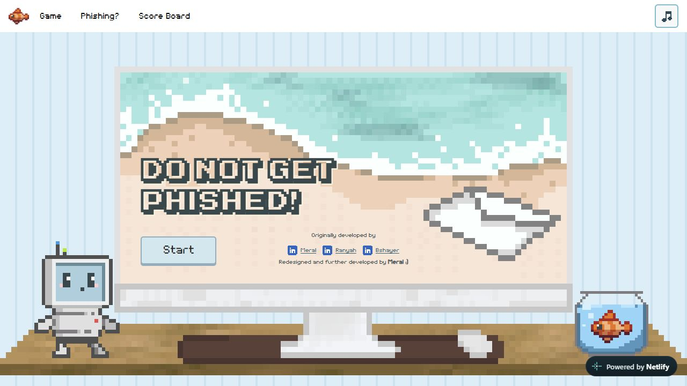
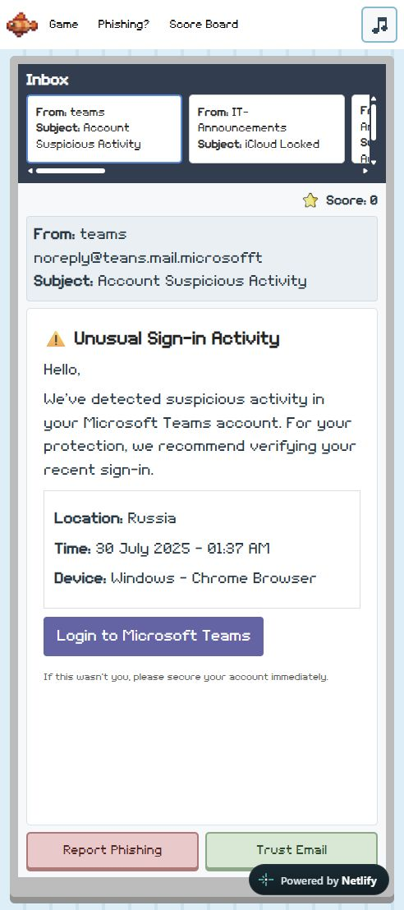
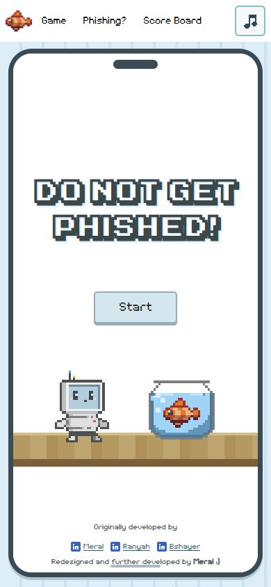
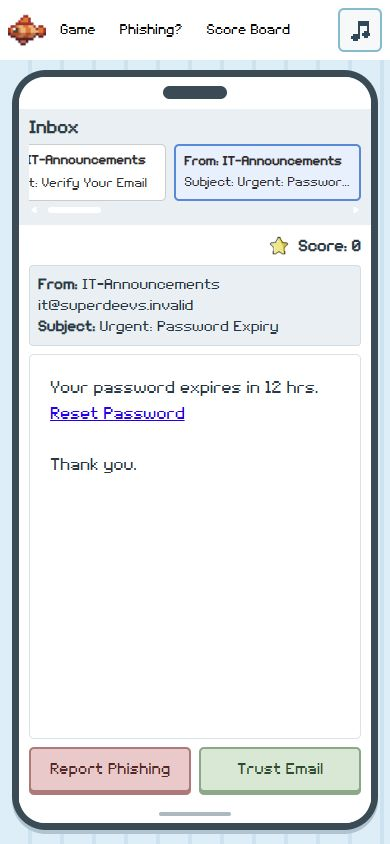

# SuperDevs phishing awareness game

A static training game with a shared scoreboard served by a Netlify Function.

## Screenshots

### Main page

### Email gameplay

### iPhone layout

Screenshots at a 390 × 844 CSS-pixel viewport.

| Menu | Email gameplay |
| --- | --- |
|  |  |

## Hosting setup

1. Create a JSONBin bin containing `{"scores": []}` in your own account.
2. Set `JSONBIN_API_KEY` and `JSONBIN_BIN_ID` in Netlify environment variables, with Functions scope (or all scopes).
3. Connect the GitHub repository to Netlify. `netlify.toml` supplies the build command, publish directory, and function directory.
4. Deploy again after setting or changing environment variables.

Never put a real key in HTML, browser JavaScript, or `netlify.toml`. The previously exposed key must be revoked by its owner.

## Development

Use Node 22 or newer. `npm run build` copies only public assets into `dist`. `npm test` runs isolated function checks with mocked JSONBin responses and no external requests.

For local function development, copy `.env.example` to `.env`, fill it privately, and run Netlify CLI's `netlify dev`. Opening HTML directly will not run the scoreboard function.

## Scoreboard limits

This is a casual, anonymous leaderboard. The server validates names and score ranges, but cannot prove a score was earned in the browser. The entry form checks leaderboard names without regard to capitalization and suggests a numbered alternative. Each submission creates a separate result; the server adds a numeric suffix if a name was taken during play, preserving the existing result. Names are not reserved and do not establish identity. Static local previews skip the online name check. JSONBin updates replace the board, so simultaneous submissions can overwrite one another; this is not an atomic uniqueness guarantee. For prizes, verified results, or heavy traffic, use authenticated server-verified games and a database with atomic updates. The board retains the top 100 records; names outside those records are not reserved.

## Responsive layout

`responsive.css` overrides the original styles. On desktop the scene keeps the artwork's actual 2:1 proportions. The current `deskAndMousepad.png` sprite is 120 x 60 pixels. Its screen interior starts at pixel (21, 7) and measures 78 x 37 pixels. The overlay uses these proportions. `assets/images/desk.png` is retained as the previous-artwork fallback; restore its earlier screen bounds (left 20%, top 15%, width 60%, height 58.3%) when reverting. Grid lays out the inbox and email inside that rectangle; only decoration uses scene positioning. Long email bodies scroll independently, leaving the answer buttons visible.

Below 900px, a taller CSS monitor frame replaces the wide desk scene. Below 600px, the inbox becomes a horizontal strip above the email. Quizzes remain inside the monitor screen. This preserves readable text instead of shrinking the whole desktop scene to a phone width.

Run `npm run preview` and open http://127.0.0.1:4173 to review the game locally. The preview serves static files only; saving scores requires Netlify. Check a desktop window, a narrow phone window, long emails, quizzes, and the end-game dialog before deploying layout changes.
